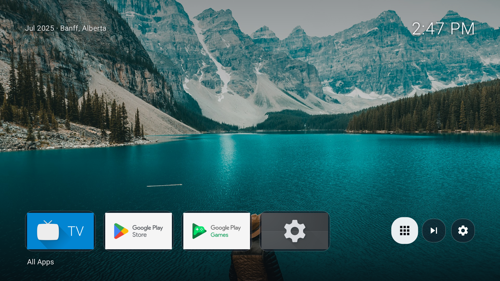
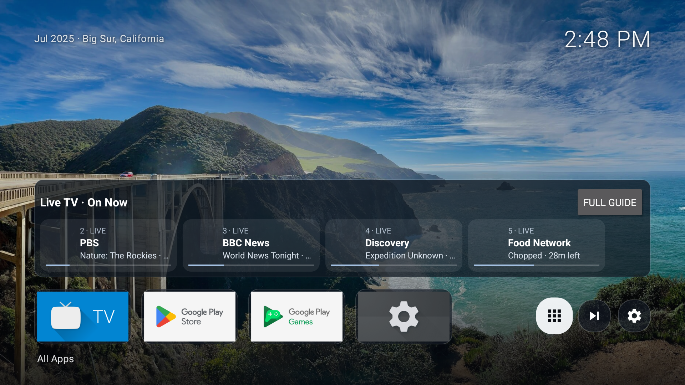
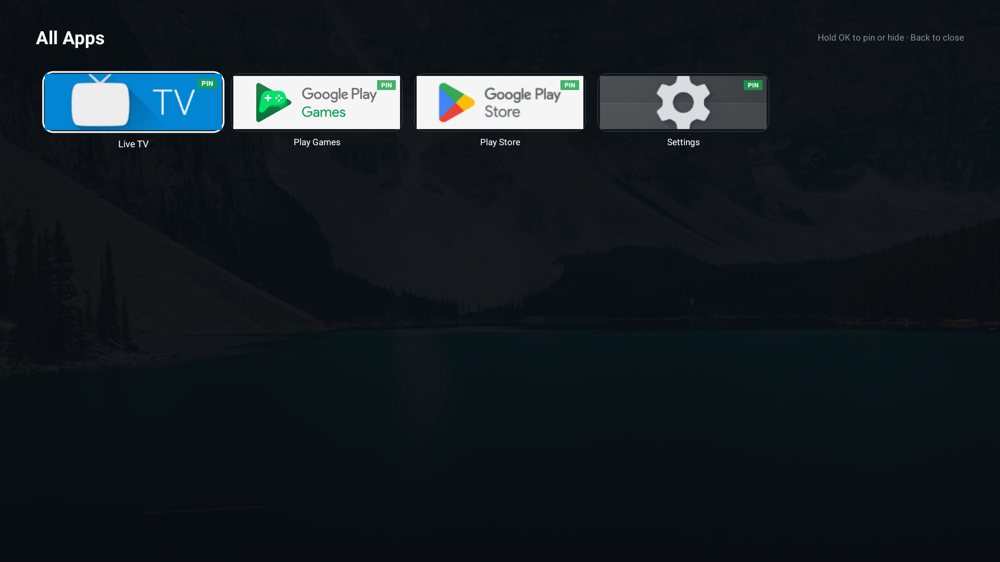
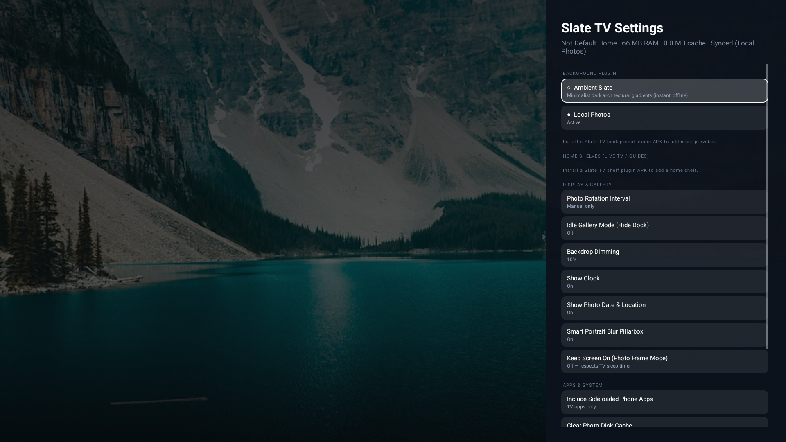
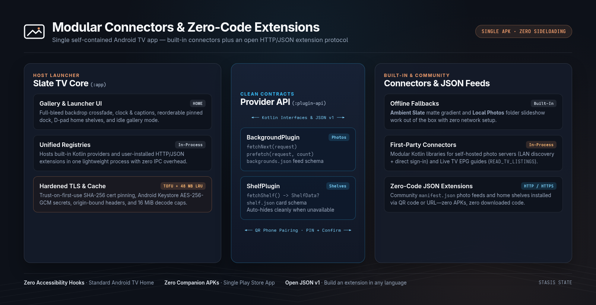

<p align="center">
  
</p>

# Slate TV

**Slate TV** (`com.stasisstate.slatetv`) is an ultra-minimal, gallery-first Android TV launcher built by Stasis State. It pairs full-bleed photo backdrops, a quiet clock and caption overlay, a pinned app dock, and an idle gallery mode with an open **AIDL Plugin Architecture** for independently installable background providers and home-screen shelves.

Slate TV is completely free and open source—with zero ads, zero paywalls, and zero locked features. Optional consumable tips (`$1`, `$3`, `$5`, `$10`, `$20`) are available in Settings when installed from Google Play and unlock nothing.

---

## Screenshots

| Full-Bleed Gallery Home | Optional Home Shelf (On Now + Guide) |
| :---: | :---: |
|  |  |

| All Apps Grid | Settings & Plugin Drawer |
| :---: | :---: |
|  |  |

---

## Open Plugin Architecture

<p align="center">
  
</p>

Slate TV discovers companion plugin APKs automatically via Android's `PackageManager` and communicates over versioned AIDL contracts in `:plugin-api`:

| Module | Application ID | Role | Release APK |
| :--- | :--- | :--- | :---: |
| **`:app`** | `com.stasisstate.slatetv` | Core Android TV launcher host (Ambient Slate + Local Photos built-in; hosts external background and home-shelf plugin APKs) | ~1.3 MB |
| **`:plugin-api`** | `com.stasisstate.slatetv.plugin.api` | Versioned AIDL interfaces (`ISlateBackgroundPlugin`, `ISlateShelfPlugin`) | Library |
| **`:plugin-immich`** | `com.stasisstate.slatetv.plugin.immich` | Standalone photo-server background plugin APK (header auth, QR phone pairing, album/favorites/recent/random modes) | ~287 KB |
| **`:plugin-jellyfin`** | `com.stasisstate.slatetv.plugin.jellyfin` | Standalone Live TV & EPG guide home-shelf plugin APK (auto-hides when Live TV is unavailable) | ~919 KB |
| **`:plugin-sample-external`** | `com.stasisstate.slatetv.plugin.sample` | Minimal reference external background plugin APK | Sample |

---

## Engineered for Fast Wake Recovery & Low Overhead

1. **No Accessibility Service Polling:** Registers cleanly as a standard Android TV `HOME` activity (`singleTask`, `stateNotNeeded`) without background accessibility hooks competing with the system launcher.
2. **HDMI-CEC & HDR Wake Hardening:** Handles display configuration changes (`colorMode`, `screenSize`, `smallestScreenSize`, `screenLayout`, `orientation`, `uiMode`, `density`) in place so HDMI-CEC wakes and SDR/HDR mode handshakes do not recreate the Activity or flash black.
3. **Zero `SurfaceView` / Video Wallpapers:** Uses hardware-accelerated double-buffered `ImageView` crossfades over an opaque `#0A0D12` window background, releasing outgoing drawables cleanly after transitions.
4. **Instant Disk Hydration & Wake Backoff:** Persists the last displayed photo per plugin in an atomic bounded LRU disk cache (`<= 48 MB`, 16 MB streaming cap, panorama pixel ceiling) and recovers smoothly on wake via `onLinkPropertiesChanged` + bounded backoff retries.
5. **Hardened Plugin Boundaries:** Strict 4-second Binder timeouts on bounded executors, circuit-breaker cooldowns, cryptographic caller signature checks in companion plugins, `PackageManager` ContentProvider UID ownership verification, `CancellationSignal`-backed `content://` reads with per-authority concurrency caps, origin-bound redirect header stripping, and strict payload sanitization.

---

## Remote Control Shortcuts

| Key | Action |
| :--- | :--- |
| **D-Pad Left / Right** | Navigate pinned dock apps, Home Shelf cards, header actions, and action pills (`Apps`, `Next`, `Settings`) |
| **OK / Center** | Launch app, open shelf item or guide, or trigger focused action |
| **Hold OK** or **Menu** | Context menu (Move Left/Right, Pin/Unpin, Hide, App Info) |
| **D-Pad Up** (from Dock) | Focuses the Home Shelf if visible → **Up** again moves to shelf header (`Full Guide` / `Next Shelf`) → **Up** again enters distraction-free Gallery Mode |
| **D-Pad Down** (from Shelf) | Moves from shelf header → shelf cards → bottom app dock |
| **Any Key** (in Gallery Mode) | Restores dock & HUD immediately |
| **Media Next** / **Channel Up** | Skips immediately to the next background photo |

---

## Building from Source

Requires JDK 17 or 21 and Android SDK (API 36). Optional release signing reads untracked `keystore.properties`; debug builds require no credentials.

```bash
# Run all unit tests across all modules (112 tests)
./gradlew testDebugUnitTest

# Build all Debug APKs
./gradlew :app:assembleDebug :plugin-immich:assembleDebug :plugin-jellyfin:assembleDebug

# Build minified Release APKs
./gradlew :app:assembleRelease :plugin-immich:assembleRelease :plugin-jellyfin:assembleRelease
```

---

## Documentation

- [Android TV Setup & Companion Plugin Guide](docs/SETUP.md)
- [Building External Background & Shelf Plugins for Slate TV](docs/PLUGIN_DEVELOPMENT.md)
- [Google Play Release & Signing Guides](docs/play/publishing.md)
