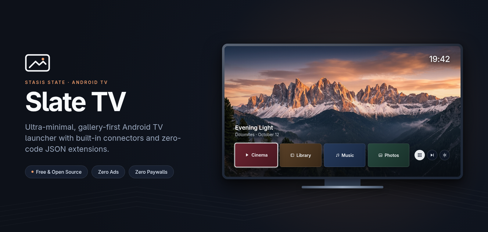

<p align="center">
  
</p>

# Slate TV

**Slate TV** (`com.stasisstate.slatetv`) is an ultra-minimal, gallery-first Android TV launcher built by Stasis State. It pairs full-bleed photo backdrops, a quiet clock and caption overlay, a reorderable pinned app dock, and an idle gallery mode with built-in photo/live-TV connectors and a zero-code **Open JSON Extension Protocol**—all inside one lightweight Android TV app with zero companion APKs required.

Slate TV is completely free and open source—with zero ads, zero paywalls, and zero locked features. Optional consumable tips (`$1`, `$3`, `$5`, `$10`, `$20`) are available in Settings when installed from Google Play and unlock nothing.

---

## Screenshots

| Full-Bleed Gallery Home | Optional Home Shelf (On Now + Guide) |
| :---: | :---: |
|  |  |

| All Apps Grid | Settings Drawer |
| :---: | :---: |
|  |  |

---

## Modular Connectors & Open JSON Extensions

<p align="center">
  
</p>

Slate TV ships as a **single self-contained APK / App Bundle**—no companion APKs, no Binder IPC, and no sideloading required. First-party connectors run in-process as isolated Gradle library modules, while community photo feeds and home shelves use a zero-code HTTP/JSON manifest protocol:

| Module | Role |
| :--- | :--- |
| **`:app`** | Core Android TV launcher host (`com.stasisstate.slatetv`) bundling built-in Ambient Slate, Local Photos, in-process connectors, and zero-code JSON extensions |
| **`:connector-immich`** | In-process photo-server background connector (mDNS discovery, direct sign-in with automatic `:2283`/scheme detection, firewall-friendly QR phone pairing via an Immich shared album, TOFU SHA-256 TLS pinning) |
| **`:connector-livetv`** | In-process Live TV & EPG guide shelf connector. Channels come only from Android TV System Live Channels via `READ_TV_LISTINGS` (no sign-in). Also hosts App Channels, which shows installed apps' home-screen rows; Jellyfin rows appear there with no Jellyfin sign-in |
| **`:connector-homeassistant`** | In-process Home Assistant connector: home-screen light/switch/scene controls and doorbell alerts with a live camera card and D-pad quick replies (long-lived access token, WebSocket live updates) |
| **`:connector-extensions`** | Zero-code Open HTTP/JSON Extension Protocol v1 for community photo feeds and home shelves (QR phone install with explicit on-TV confirmation) |
| **`:plugin-api`** | Clean Kotlin interfaces (`BackgroundPlugin`, `ShelfPlugin`) shared by built-in connectors and JSON extensions |

---

## Engineered for Fast Wake Recovery & Low Overhead

1. **No Accessibility Service Polling:** Registers cleanly as a standard Android TV `HOME` activity (`singleTask`, `stateNotNeeded`) without background accessibility hooks competing with the system launcher.
2. **HDMI-CEC & HDR Wake Hardening:** Handles display configuration changes (`colorMode`, `screenSize`, `smallestScreenSize`, `screenLayout`, `orientation`, `uiMode`, `density`) in place so HDMI-CEC wakes and SDR/HDR mode handshakes do not recreate the Activity or flash black.
3. **Zero `SurfaceView` / Video Wallpapers:** Uses hardware-accelerated double-buffered `ImageView` crossfades over an opaque `#0A0D12` window background, releasing outgoing drawables cleanly after transitions.
4. **Instant Disk Hydration & Wake Backoff:** Persists the last displayed photo per plugin in an atomic bounded LRU disk cache (`<= 48 MB`, 16 MB streaming cap, panorama pixel ceiling) and recovers smoothly on wake via `onLinkPropertiesChanged` + bounded backoff retries.
5. **Hardened Network & Extension Boundaries:** Trust-on-first-use (TOFU) SHA-256 certificate pinning (zero trust-all `X509TrustManager`), Android Keystore AES-256-GCM secret encryption, origin-bound redirect header stripping, HTTP 303 body-header stripping, JSON nesting/size caps, strict launch URI allowlists, and explicit on-TV confirmation before installing any JSON extension.

---

## Remote Control Shortcuts

| Key | Action |
| :--- | :--- |
| **D-Pad Left / Right** | Navigate pinned dock apps, Home Shelf cards, header actions, and action pills (`Apps`, `Next`, `Settings`) |
| **OK / Center** | Launch app, open shelf item or guide, or trigger focused action |
| **Hold OK** or **Menu** | Context menu (**Move / Reorder** continuous D-Pad sliding, Pin/Unpin, Hide, App Info) |
| **D-Pad Up** (from Dock) | Focuses the Home Shelf if visible → **Up** again moves to shelf header (`Full Guide` / `Next Shelf`) → **Up** again enters distraction-free Gallery Mode |
| **D-Pad Down** (from Shelf) | Moves from shelf header → shelf cards → bottom app dock |
| **Any Key** (in Gallery Mode) | Restores dock & HUD immediately |
| **Media Next** / **Channel Up** | Skips immediately to the next background photo |

---

## Building from Source

Requires JDK 17+ (builds natively on JDK 27) and Android SDK (API 37). Optional release signing reads untracked `keystore.properties`; debug builds require no credentials.

```bash
# Run all unit tests across all modules
./gradlew testDebugUnitTest

# Build Debug APK
./gradlew :app:assembleDebug

# Build minified Release APK / Signed App Bundle
./gradlew :app:assembleRelease
./gradlew :app:bundleRelease
```

---

## Documentation & Links

- [Slate TV Product Page](https://stasisstate.com/slatetv.html)
- [Slate TV Privacy Policy](https://stasisstate.com/slatetv-privacy.html)
- [Android TV Setup Guide](docs/SETUP.md)
- [Developing Zero-Code JSON Extensions for Slate TV](docs/PLUGIN_DEVELOPMENT.md)
- [Google Play Release & Signing Guides](docs/play/publishing.md)
